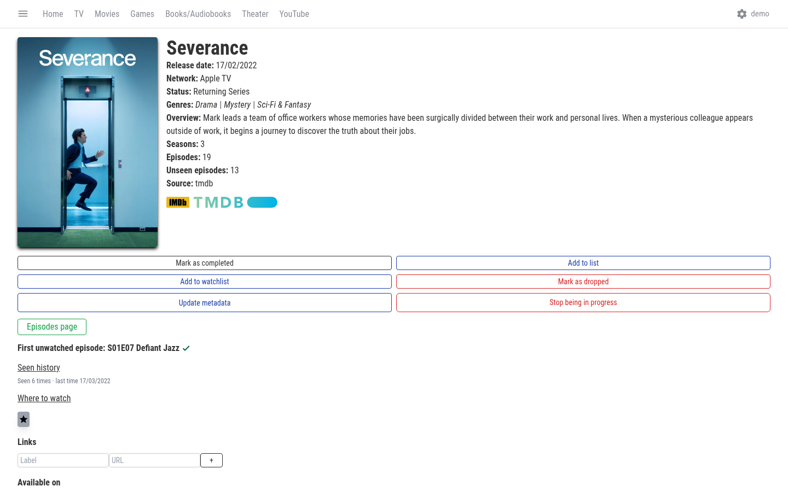
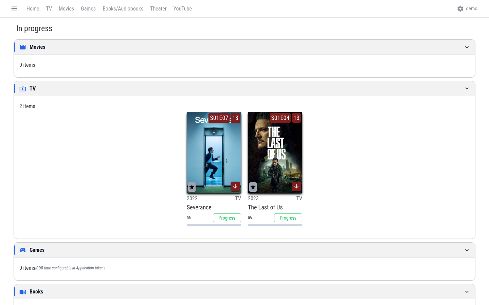

<p align="center"></p>

<h1 align="center">MediaOCD</h1>

<p align="center">
<a href="https://github.com/javimentallab/mediaocd/actions/workflows/build.yml"></a>
<a href="https://github.com/javimentallab/mediaocd/actions/workflows/trivy-scan.yml"></a>
<a href="https://github.com/javimentallab/mediaocd/releases/latest"></a>
<a href="./LICENSE"></a>
</p>

> *A media tracker for the obsessively organised — the kind of person who cares which one of the 14 productions of "La casa de Bernarda Alba" they actually saw.*

Self-hosted tracker for everything you watch, read, play, listen to and attend — movies, TV, video games, books, audiobooks, theatre and YouTube videos — with the level of detail that the rest of the trackers don't bother with.

<p align="center">
  
  
</p>

---

## What it is

A media tracker built for **completionists**, Spanish-first and translated into 16 languages:

- **Per-medium consumption verbs**, not just "seen": played / watched / read / listened / attended. The same item can have several.
- **"In progress" page that keeps itself tidy**: everything you are watching, reading, playing or listening to, for every media type. Airing shows stay while you are up to date, the card shows the next episode (even one you watched ahead of its air date) and a show leaves by itself when its season or series ends. Abandoned items have their own list. You can make it your start page.
- **Progress in real units**: hours and minutes for movies, games, theatre and episodes; pages for books; position for audiobooks, with a chapter indicator over the read / listen bars and the real chapter count of Audible audiobooks.
- **Two-way Jellyfin integration**: marks items as downloaded when they appear in your Jellyfin library, opens "Play in Jellyfin" deeplinks, sync-back when you watch something there.
- **YouTube as a first-class media type**: subscribe to channels, mark videos watched, view the recent feed, persistent cache that survives YouTube's RSS outages.
- **Theatre with serious metadata**: Wikidata SPARQL for canonical works + scraping of teatro.es (CDT/INAEM, Spain) for contemporary stagings.
- **Watchlist ordered by date added**; finished shows leave it automatically.
- **External scores on the details page**: FilmAffinity rating for movies and TV shows, Metacritic Metascore for games, shown next to the IMDb/TMDB/IGDB logos and cached server-side.
- **Duplicate detection** and merge tooling that doesn't lose seen / ratings / lists.
- **Full backup / restore** including auto-restore on missing data.db, plus JSON and Letterboxd CSV exports.
- **16 interface languages**: English, Spanish, Portuguese, French, German, Italian, Dutch, Polish, Russian, Ukrainian, Danish, Chinese, Japanese, Korean, Thai and Hindi. It follows the browser's language; *Settings → Configuration → UI language* forces one.

Designed to live in your own infrastructure next to Jellyfin, qBittorrent, Home Assistant and whatever else.

## Install

Requires Docker Engine 20+ with the Compose v2 plugin.

```sh
git clone https://github.com/javimentallab/mediaocd.git
cd mediaocd

cp docker-compose.example.yml docker-compose.yml
${EDITOR:-nano} docker-compose.yml      # optional Jellyfin / YouTube (Google OAuth)

docker compose build mediaocd
docker compose up -d mediaocd
```

Open `http://localhost:7481` — the first user to register becomes admin.

**Tokens and credentials** are managed from `Settings → Application tokens`:
- IGDB (required for video games)
- TMDB API key (recommended for "Where to watch" providers and episode runtimes — paste it in the UI; it's stored at `/storage/tmdb-key.json` with mode 0600)
- Jellyfin (URL + API key)
- YouTube (Google OAuth)

To put it behind your own domain, see [`SETUP_DOMAIN.md`](SETUP_DOMAIN.md).

## Custom endpoints

| Method | Path | Purpose |
|---|---|---|
| `GET` | `/api/backup` | Download binary `data.db` (admin) |
| `GET` | `/api/backup/export-json` | Full JSON export (admin) |
| `GET` | `/api/backup/letterboxd` | CSV importable into letterboxd.com (admin) |
| `POST` | `/api/backup/restore` | Upload `.db` to restore on next restart (admin) |
| `POST` | `/api/backup/import` | Merge a JSON export (matches by TMDB/IMDB/IGDB/TVDB) (admin) |
| `POST` | `/api/catalog/cleanup` | Purge orphan mediaItems (admin) |
| `GET` `/POST` | `/api/dupes` | Detect and merge duplicates (admin) |
| `PATCH` | `/api/downloaded` | Toggle the "downloaded" flag |
| `GET` `/PUT` | `/api/links` | External links per item |
| `GET` | `/api/watch-providers` | Where-to-watch (TMDB providers) |
| `PUT` | `/api/audio-progress` | Listening progress |
| `PUT` | `/api/episode-progress` | Per-episode progress |
| `POST` | `/api/episodes/fetch-runtimes` | Refresh episode runtimes (TMDB) |
| `GET` | `/api/hltb` | HowLongToBeat data for a game |
| `GET` | `/api/filmaffinity` | FilmAffinity rating for a movie/TV item (`?mediaItemId=`) |
| `GET` | `/api/metacritic` | Metacritic Metascore for a game (`?mediaItemId=`) |
| `GET` `/PUT` | `/api/tmdb/key` | TMDB API key managed via UI (admin) |
| `GET` `/POST` `/DELETE` | `/api/youtube/channels` | YouTube subscriptions |
| `GET` | `/api/youtube/feed` | Recent videos (`?fresh=1` to bypass the cache) |
| `*` | `/api/youtube/oauth/*` | Google OAuth (start/callback/status/sync) |
| `POST` `/DELETE` | `/api/youtube/watched` | Mark / unmark a video as watched |
| `GET` | `/api/youtube/watched-stats` | User's watched-video totals |
| `GET` `/POST` | `/api/jellyfin/*` | Status, sync, config (admin) |

## Companion: `contrib/jf-torrents-organize`

Optional but recommended if you run **qBittorrent + Jellyfin** alongside MediaOCD.

qBittorrent saves torrents at release-style paths
(`/data/torrents/Title (YYYY) [Bluray 1080p][Esp]/foo.mkv`). Jellyfin matches
metadata poorly against those names, so MediaOCD's **Downloaded** badge —
which reads from Jellyfin — never lights up. The fix isn't to rename the
qBit folder (that breaks seeding); it's to create **hardlinks** in a clean
parallel structure that Jellyfin indexes correctly. Same inode, zero extra
bytes on disk.

`contrib/jf-torrents-organize/` ships a small Python script + systemd units
that do exactly that, plus a `/Library/Refresh` call to Jellyfin so the new
entries appear immediately. It reads the Jellyfin URL + API key directly
from MediaOCD's own storage (`/storage/jellyfin-config.json`) so if you
already configured Jellyfin in MediaOCD, no extra credentials needed.

See [`contrib/jf-torrents-organize/README.md`](contrib/jf-torrents-organize/README.md)
for layout requirements, env vars and footguns.

## Host-side backups

The image doesn't ship a cron — recommended pattern:

```cron
0 3 * * * /path/to/backup-mediaocd.sh >> /path/to/backup.log 2>&1
30 3 * * * bash /path/to/verify-backup.sh --quiet >> /path/to/verify.log 2>&1
```

Both scripts use `docker exec mediaocd` and rotate keeping 7 daily / 4 weekly / 3 monthly. Best to keep them outside the image, next to the data volume.

## Development

There is no build step: the image copies `app/` as is on top of the official Node image
and installs the dependencies from `app/package-lock.json`.

```
.
├── app/
│   ├── build/              # server (Node, Express, SQLite via knex): edit the .js files directly
│   ├── public/             # web client: index.html, the bundle main_*.js, CSS, service worker, icons
│   ├── package.json        # dependencies; app/package-lock.json pins the exact tree
│   └── package-lock.json
├── docker/entrypoint.sh    # PUID/PGID, auto-restore of data.db from the latest backup, start
├── tools/rehash-web.js     # run after editing app/public (renames the bundle, bumps the service worker)
├── docs/                   # logo
├── contrib/                # jf-torrents-organize
├── Dockerfile
├── docker-compose.example.yml
├── release.sh
└── .github/workflows/
    ├── build.yml           # builds the image, starts it and checks that it answers
    └── trivy-scan.yml      # CVE scan on push/PR/weekly + SARIF to the Security tab
```

- **Server changes**: edit `app/build/**`, rebuild the image (`docker compose up -d --build mediaocd`).
- **Web client changes**: edit `app/public/main_*.js` / `.css` / `index.html`, then run
  `node tools/rehash-web.js` before building, so browsers and the service worker pick up the new files.
- **Translations** live in the bundle, one catalogue per language (search for `"In progress":`).
- **Dependencies**: edit `app/package.json`, build, then refresh the lock with
  `docker cp mediaocd:/app/package-lock.json app/`.
- **Node**: change tag and digest in the `FROM` line of the `Dockerfile`.

## Releasing

```sh
./release.sh 1.2.0
```

- Aborts if the working tree is dirty, the branch isn't `main`, the tag already exists or the version isn't semver.
- Bumps the version in `app/build/config.js` and `app/package.json`.
- Commits, tags `v1.2.0`, pushes both and drafts a GitHub release with the commit log since the previous tag, for you to edit before publishing.

## License

MIT — see [`LICENSE`](LICENSE).
